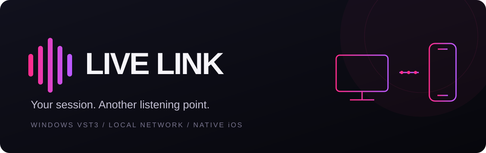
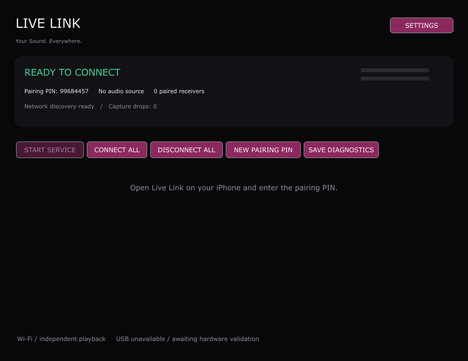
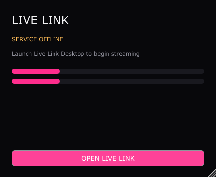
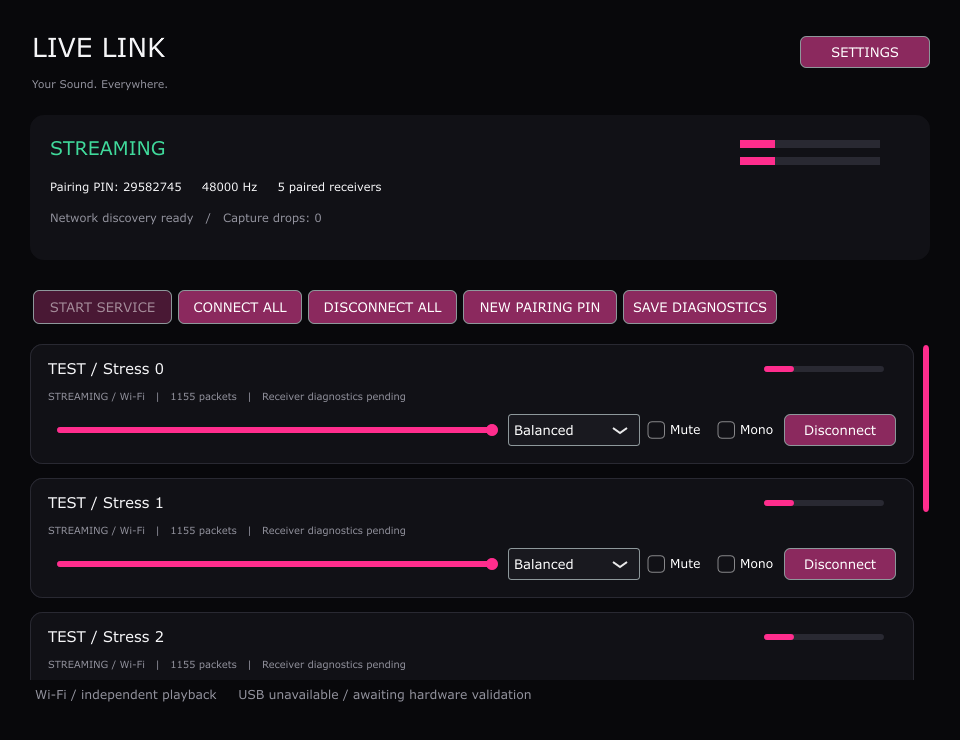

<p align="center">
  
</p>

<p align="center">
  <strong>English</strong> &nbsp; / &nbsp; <a href="README.ru.md">Русский</a>
</p>

<p align="center">
  <a href="https://github.com/stth12/LiveLink/actions/workflows/windows.yml"></a>
  
  
  <a href="LICENSE"></a>
</p>

<p align="center"><strong>Listen to your Windows DAW on iPhone over your local network.</strong></p>

---

## A new listening point for your session

Live Link sends a stereo copy of your DAW output to a native iPhone receiver.
Keep your normal audio output and control each receiver independently from the
Windows dashboard.

| Windows | Connection | iPhone |
| :--- | :---: | :--- |
| VST3 plugin · desktop controller · background process | Local-network PCM streaming | SwiftUI interface · RemoteIO playback |

> **Early release · 0.1.0**<br>
> Windows builds and automated tests pass. A user has confirmed local-network
> connection and audible playback on a physical iPhone. USB streaming is not implemented.

## Preview



<details>
<summary>View the VST3 plugin and receiver controls</summary>





The receiver screenshot shows explicitly labelled software test clients.
It illustrates the controls, rather than a multi-iPhone hardware test.

</details>

## What you can do

| Feature | Details |
| :--- | :--- |
| Keep your original output | Bit-identical stereo VST3 pass-through with a separate network copy |
| Listen on multiple receivers | Up to 16 sessions with individual volume, mute and mono controls |
| Pair quickly | Bonjour discovery, manual IPv4 fallback and an eight-digit PIN |
| Adjust buffering | Packet reordering, adaptive buffering and bounded drift correction |
| Use a native receiver | SwiftUI controls, RemoteIO audio and background audio support |
| Start with Windows | Installer, optional startup and private-network firewall configuration |

## Get started

1. **Windows:** build and install the controller, background process and VST3
   plugin following [the Windows guide](docs/BUILD_WINDOWS.md).
2. **iPhone:** build, sign and install the receiver using
   [xtool](docs/BUILD_IOS_XTOOL.md) or [Xcode](docs/BUILD_IOS.md).
3. **Pair:** connect both devices to the same trusted local network. Open Live
   Link, allow local-network access on iPhone, select your computer and enter its PIN.
4. **Play:** insert Live Link on your DAW's stereo master bus and start playback.
   Keep your usual DAW output enabled.

If discovery fails, connect using the computer's IPv4 address. See
[installation and usage](docs/INSTALLATION.md) for details.

## Build from source

### Windows

Requires Visual Studio's C++ desktop workload, Windows SDK, CMake and Git.
CMake fetches JUCE 8.0.6 from upstream.

```powershell
./scripts/build_windows.ps1
./scripts/run_tests.ps1 -Integration
./scripts/package_windows.ps1 -ISCC 'C:/Program Files (x86)/Inno Setup 6/ISCC.exe'
```

### iOS

With xtool and the Darwin Swift SDK configured:

```sh
bash scripts/build_ios_xtool.sh
```

The default IPA is unsigned. Signing and provisioning are required to install
on a standard iPhone. Build outputs are excluded from Git; release binaries
are distributed separately when available.

## Current boundaries

- **Trusted networks:** control messages and audio are not encrypted.
- **Transport:** IPv4 only; USB is unavailable.
- **Capture:** one plugin owns the audio source per Windows user.
- **Audio:** sample-rate conversion uses linear interpolation. End-to-end
  latency and synchronized acoustic playback have not been measured.
- **Validation:** broad DAW compatibility, multiple physical receivers and
  long-running hardware behavior still require testing.

## Explore the project

| Guide | Contents |
| :--- | :--- |
| [Architecture](docs/ARCHITECTURE.md) | Components, threads and failure handling |
| [Audio protocol](docs/AUDIO_PROTOCOL.md) | Packet format and control operations |
| [Validation status](docs/BUILD_RESULTS.md) · [Testing](docs/TESTING.md) | Verified results and remaining hardware checks |
| [USB research](docs/USB_RESEARCH.md) | Candidate transport and current limitations |
| [Contributing](CONTRIBUTING.md) · [Security](SECURITY.md) | Contribution guidelines and security reporting |

## License

**AGPL-3.0-or-later.** See [LICENSE](LICENSE), [COPYING](COPYING) and
[third-party notices](THIRD_PARTY_NOTICES.md). JUCE uses its AGPL licensing
option; proprietary distribution requires appropriate licensing.

---

<p align="center"><a href="README.md">English</a> &nbsp; / &nbsp; <a href="README.ru.md">Русский</a></p>
